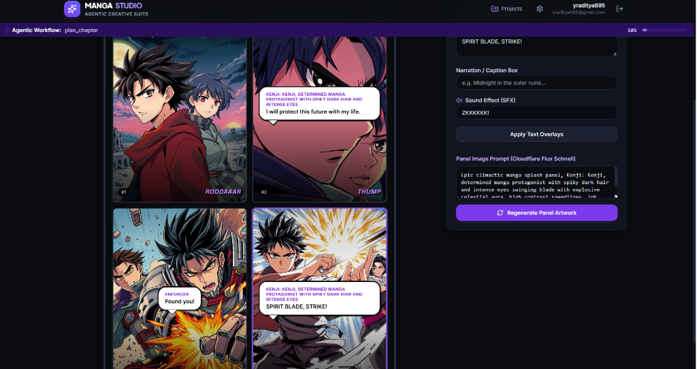
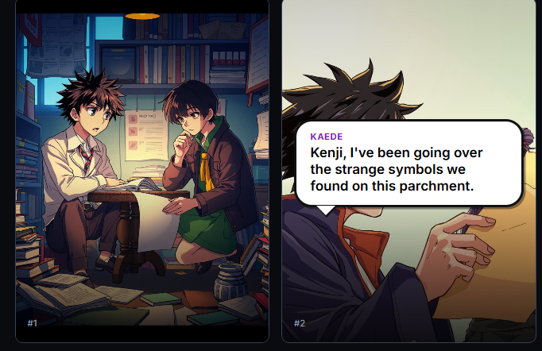
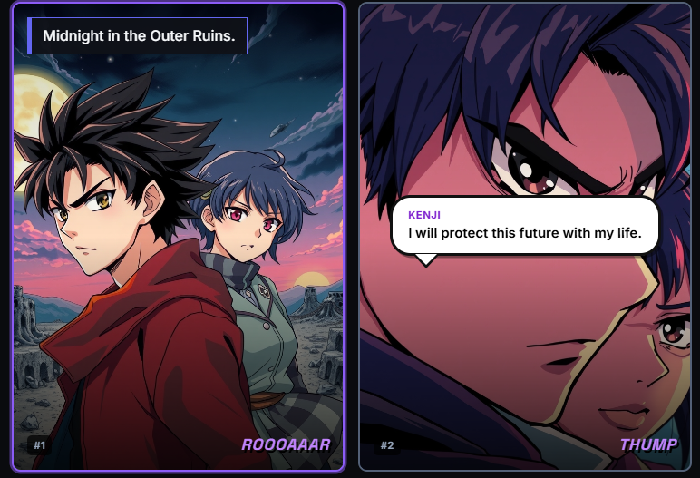
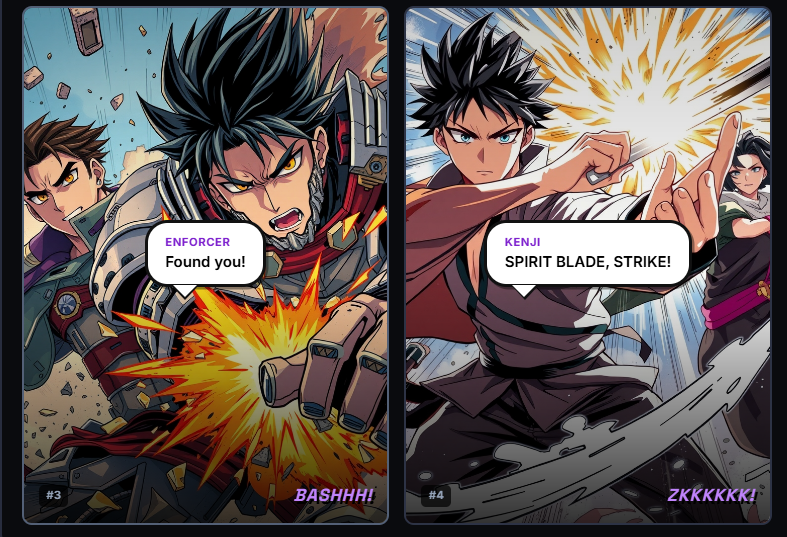
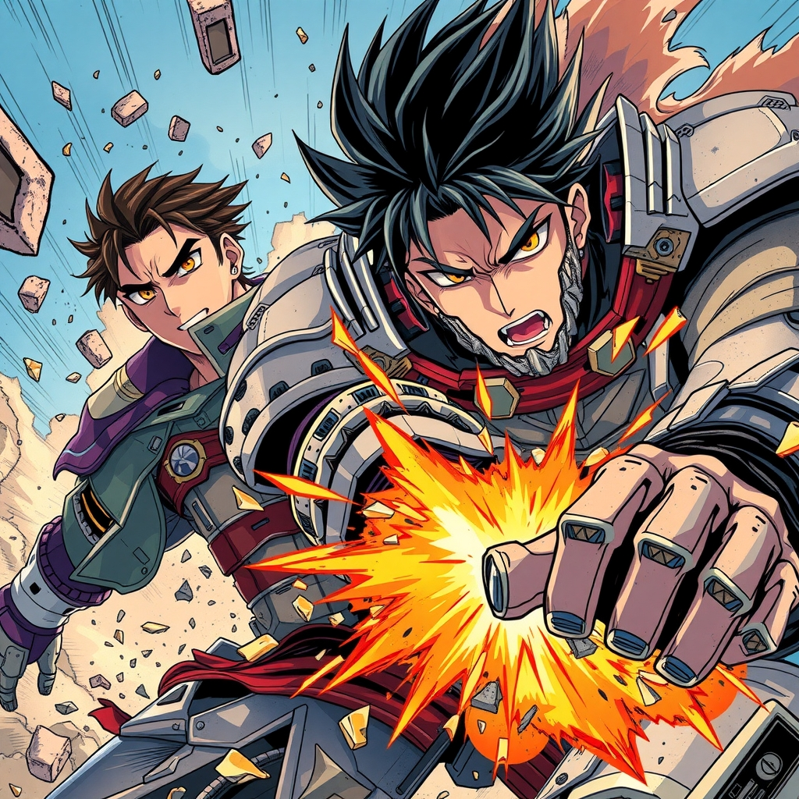
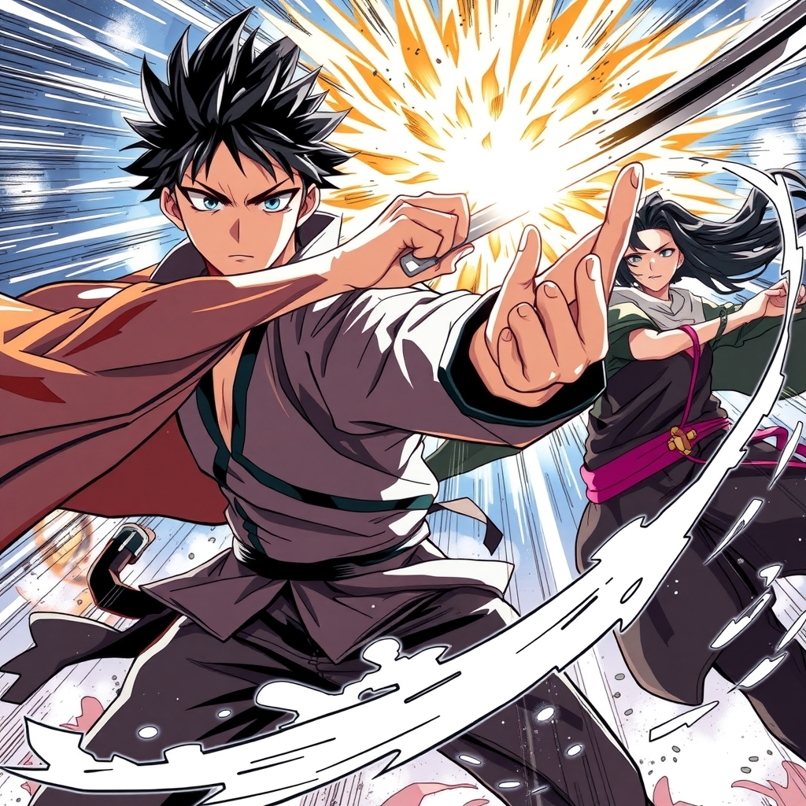
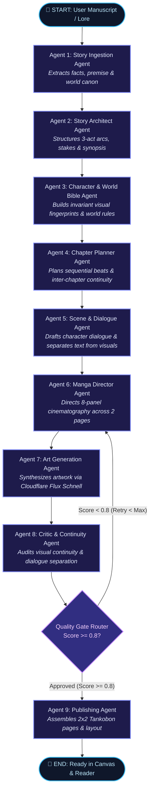
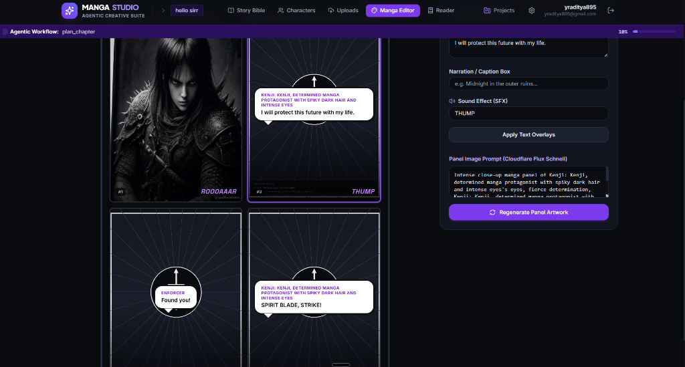

<div align="center">

# ⛩️ AI MANGA STUDIO
### Autonomous Multi-Agent Manga & Comic Creation Platform powered by LangGraph, Cloudflare Workers AI (Flux 1 Schnell), and OpenRouter

[](https://fastapi.tiangolo.com)
[](https://langchain-ai.github.io/langgraph/)
[](https://developers.cloudflare.com/workers-ai/)
[](https://openrouter.ai/)
[](https://react.dev/)
[](https://python.org)

<br/>

<p align="center">
  
</p>

<p align="center">
  <b>Transform manuscripts, story ideas, and world lore into production-grade manga chapters with multi-page narrative pacing, consistent character visual anchors, editable speech bubbles, and authentic Tankobon PDF publishing.</b>
</p>

[Key Features](#-key-features) • [Visual Showcase](#-visual-gallery--generated-panels) • [LangGraph Multi-Agent Architecture](#-the-9-agent-langgraph-workflow) • [Character Consistency Engine](#-character-consistency--visual-fingerprinting) • [Interactive Canvas](#-interactive-canvas--dialogue-studio) • [Getting Started](#-setup--quickstart)

---

</div>

<br/>

## 🎨 Visual Gallery & Generated Panels

AI Manga Studio orchestrates professional sequential storytelling with varied camera angles, dynamic lighting, and persistent character identity across every page.

<div align="center">

### 📖 Sequential Manga Page Flow

| 🏛️ Scene 1: Discovery & Mystery | 🌙 Scene 2: Tension & Resolve | ⚡ Scene 3: Climax & Combat Impact |
|:---:|:---:|:---:|
|  |  |  |
| *"Kenji, I've been going over the strange symbols we found on this parchment."* | *"Midnight in the Outer Ruins... I will protect this future with my life."* | *"Enforcer: Found you! — Kenji: SPIRIT BLADE, STRIKE!"* |

<br/>

### 🖼️ High-Fidelity Artwork Synthesis (Cloudflare Flux 1 Schnell)

| ⚔️ High-Contrast Action Linework | 🌌 Cinematic Atmosphere & Shading |
|:---:|:---:|
|  |  |
|  |  |

</div>

---

## ⚡ Key Features

- **9-Agent LangGraph Pipeline**: End-to-end autonomous story conversion from raw manuscript to fully illustrated manga tankobon chapters.
- **Multi-Page Structured Directing**: Generates 8 distinct panels across 2 full pages with cinematic variety (Establishing shots, medium character action, Dutch-tilt tension, page-turn cliffhangers, and explosive action splashes).
- **Invariant Character Fingerprinting**: Solves diffusion character drift by locking concrete visual anchors (hair style/color, iris color, facial marks, signature costume garments, and accessories) into every panel.
- **Establishing Landscape Protection**: Intelligently suppresses character prompt leakage during environmental wide shots to prevent hallucinated portraits in scenery.
- **Prompt Attention Hierarchy**: Places unique shot composition and action *first*, character anchors *second*, and concise manga inking tokens *last*, maximizing Flux Schnell transformer attention.
- **Interactive Manga Canvas**:
  - Live 2x2 grid layout editor with draggable/repositionable speech bubbles, thought balloons, narration boxes, and sound effects (SFX).
  - Single-panel targeted AI regeneration with custom prompt tweaking without disturbing adjacent panels.
  - Real-time generation progress streamed via Server-Sent Events (SSE).
- **Authentic Manga Reader**:
  - Full-screen page reader supporting authentic **Right-to-Left (RTL Japanese Manga)** and **Left-to-Right (LTR Western Comic)** reading directions.
- **Print-Ready Tankobon PDF Exporter**:
  - Built with ReportLab to generate true B5 (Japanese Tankobon standard), A4, and Letter format PDFs with embedded cover art, panel borders, bubbles, captions, and page numbers.
- **Robust Cloud LLM & Local Mock Fallback**:
  - Primary LLM: OpenRouter (`meta-llama/llama-3.3-70b-instruct` / `anthropic/claude-3.5-sonnet`) with automatic fallback to Cloudflare Workers AI (`@cf/meta/llama-3.1-8b-instruct`).
  - Zero-credential offline mock engine providing high-contrast manga drawings and deterministic agent reasoning when keys are not configured.

---

## 🤖 The 9-Agent LangGraph Workflow

AI Manga Studio uses an asynchronous **LangGraph StateGraph** where each specialized agent performs a discrete creative role with structured JSON contracts and automated quality gates:



<br/>

### Detailed Agent Responsibilities

| # | Agent Name | Primary Responsibility | Output Artifact |
|---|---|---|---|
| **1** | **Story Ingestion Agent** | Parses uploaded `.txt`, `.pdf`, `.docx` documents or prompts; isolates core facts and eliminates ambiguities. | Extracted Premise, Facts, Raw Canon |
| **2** | **Story Architect Agent** | Designs overarching narrative arc, stakes, thematic conflicts, and multi-chapter timeline. | 3-Act Arcs, Global Synopsis |
| **3** | **Character & World Bible Agent** | Establishes canonical character records with immutable visual traits (hair, eyes, signature outfit, accessories) and worldbuilding rules. | Canonical Characters & World Bible |
| **4** | **Chapter Planner Agent** | Inspects previous chapter summaries to maintain continuous narrative momentum; drafts dramatic beats. | Chapter Objectives & Beat Breakdown |
| **5** | **Scene & Dialogue Agent** | Transforms beats into dramatic scenes with emotional, natural dialogue, keeping spoken text strictly separate from visual prompts. | Scene Scripts with Separated Dialogue |
| **6** | **Manga Director Agent** | Directs 8 panels across 2 full pages, ensuring varied camera angles (Wide, Medium, Dutch Tilt, Close-up, Two-shot, Diagonal Splash). | 8-Panel Cinematography & Prompts |
| **7** | **Art Generation Agent** | Injects character visual anchors, detects environmental landscape shots, and invokes Cloudflare Flux 1 Schnell. | Assembled Image Assets & Checksums |
| **8** | **Critic & Continuity Agent** | Evaluates prompt-text leakage, checks character identity consistency, and scores chapter quality ($0.0 - 1.0$). | Quality Score & Revision Routing |
| **9** | **Publishing Agent** | Organizes panels into 2x2 Tankobon grids, applies Right-to-Left or Left-to-Right layout, and prepares export packages. | Manga Pages Ready for Canvas/Export |

---

## 🎯 Character Consistency & Visual Fingerprinting

One of the largest hurdles in AI comic creation is character drift across sequential panels. Because Cloudflare Workers AI Flux Schnell enforces a strict payload schema (`prompt`, `steps`, `image`) without seed pinning, AI Manga Studio implements an **Invariant Visual Fingerprint System**:

<div align="center">
  
</div>

<br/>

### 1. The Visual Fingerprint Generator
Instead of passing vague descriptions like *"Kenji, a determined warrior"*, the system compiles an invariant fingerprint:

```python
# Generated by Agent 3 & Injected into Agent 7
"Kenji: messy spiky jet-black hair with twin temple bangs, sharp amber-gold eyes, "
"thin cross scar under left eye, high-collared charcoal sleeveless tunic over white long-sleeve shirt, "
"wearing black fingerless combat gloves, crimson sash belt"
```

### 2. Prompt Attention Hierarchy
In modern flow-matching diffusion transformers, the initial tokens receive the strongest cross-attention weight. The prompt is assembled in strict priority order:

```
[1. Shot Angle & Action] -> [2. Character Visual Anchor] -> [3. Manga Art Style Guidance]
```

* **Example Action Panel**:
  > `"Extreme close-up manga panel: sharp glare, sweat dripping, sparks flying. Featuring Kenji: messy spiky jet-black hair with twin temple bangs, sharp amber-gold eyes, thin cross scar under left eye, high-collared charcoal sleeveless tunic. Style: traditional Japanese manga panel, crisp bold ink linework, screentone shading, high contrast monochrome, no text, no speech bubbles."`

### 3. Landscape Isolation
When a panel is an environmental establishing shot (`Wide panoramic view of ancient ruins`), the system detects the lack of dialogue speakers and landscape keywords, automatically suppressing character descriptions so Flux never hallucinates stray faces in the scenery.

---

## 🖥️ Interactive Canvas & Dialogue Studio

<div align="center">
  
  
</div>

- **Live Speech Bubble Editor**: Click on any panel to edit dialogue text, speaker names, and bubble styles (`Speech`, `Thought`, `Shout`).
- **Narration Boxes & SFX**: Add top/bottom caption boxes and Japanese/English onomatopoeia (`ROOOAAAR`, `BASHHH!`, `ZKKKKKK!`) with custom positioning.
- **Targeted Regeneration**: Change an image prompt and regenerate *only* that specific panel without rebuilding the rest of the page.
- **Manga Reader**: Switch to Reader mode to experience your story in continuous Right-to-Left flow.
- **Export to Tankobon PDF**: One-click download of a high-resolution, print-ready PDF formatted to Japanese B5 book proportions.

---

## 🛠️ Technology Stack

### Backend
- **Framework**: [FastAPI](https://fastapi.tiangolo.com/) (Python 3.11+)
- **Multi-Agent Orchestration**: [LangChain](https://www.langchain.com/) & [LangGraph](https://langchain-ai.github.io/langgraph/)
- **Database**: [SQLAlchemy 2.0](https://www.sqlalchemy.org/) Async Engine (SQLite for dev, PostgreSQL ready for prod)
- **Migrations**: [Alembic](https://alembic.sqlalchemy.org/)
- **Publishing & PDF**: [ReportLab](https://www.reportlab.com/) (Deterministic Tankobon B5 generator)
- **Image Processing**: [Pillow (PIL)](https://python-pillow.org/)
- **Document Extraction**: [PyPDF](https://pypi.org/project/pypdf/) & [python-docx](https://python-docx.readthedocs.io/)
- **Authentication**: JWT tokens with [PyJWT](https://pyjwt.readthedocs.io/) & bcrypt password hashing
- **Testing**: [Pytest](https://docs.pytest.org/) & pytest-asyncio (100% test pass rate)

### Frontend
- **Framework**: [React 19](https://react.dev/) with [Vite](https://vitejs.dev/)
- **Language**: Pure JavaScript & JSX (`.js`, `.jsx`) — Zero TypeScript configuration
- **Styling**: [Tailwind CSS](https://tailwindcss.com/) with custom dark manga palette (`#0a0b0e`, `#12141a`, `#161922`, `#7c3aed`)
- **Routing**: React Router v6
- **Server State**: [TanStack Query](https://tanstack.com/query) (React Query)
- **Client State**: [Zustand](https://github.com/pmndrs/zustand)
- **Real-Time Updates**: Native Server-Sent Events (SSE) via custom `useSSE` hook
- **Icons**: [Lucide React](https://lucide.dev/)

### AI Providers
- **Cloudflare Workers AI**: `@cf/black-forest-labs/flux-1-schnell` for image generation + `@cf/meta/llama-3.1-8b-instruct` as fallback LLM.
- **OpenRouter**: Access to `meta-llama/llama-3.3-70b-instruct`, `anthropic/claude-3.5-sonnet`, and other state-of-the-art models.

---

## 🚀 Setup & Quickstart

### Prerequisites
- Python 3.11+
- Node.js 18+ (tested on v20 and v24)
- Git

### 1. Clone & Configure Environment
```bash
git clone https://github.com/aditya0589/manga.git
cd manga
cp .env.example .env
```

Edit `.env` (or `backend/.env`) with your API keys:
```env
# AI Providers
OPENROUTER_API_KEY=your_openrouter_api_key_here
OPENROUTER_MODEL=meta-llama/llama-3.3-70b-instruct:free

CLOUDFLARE_ACCOUNT_ID=your_cloudflare_account_id_here
CLOUDFLARE_API_TOKEN=your_cloudflare_api_token_here
CLOUDFLARE_IMAGE_MODEL=@cf/black-forest-labs/flux-1-schnell

# App Configuration
DATABASE_URL=sqlite+aiosqlite:///./manga_studio.db
STORAGE_BACKEND=local
MEDIA_ROOT=./media
```

*(Note: If API keys are omitted, AI Manga Studio automatically runs in **Zero-Credential Studio Mock Mode**, generating high-contrast stylized panels and mock agent scripts).*

---

### 2. Backend Setup
```bash
# Create and activate virtual environment
python -m venv .venv
# On Windows:
.\.venv\Scripts\activate
# On Linux/macOS:
source .venv/bin/activate

# Install dependencies
pip install -r backend/requirements.txt

# Run migrations
cd backend
python -m alembic upgrade head

# Start FastAPI server
uvicorn app.main:app --host 127.0.0.1 --port 8000 --reload
```
Interactive OpenAPI documentation will be live at: `http://127.0.0.1:8000/docs`

---

### 3. Frontend Setup
In a new terminal:
```bash
cd frontend
npm install

# Build client bundle
npm run build

# Start Vite dev server
npm run dev -- --host 127.0.0.1 --port 5173
```
Open your browser and navigate to: `http://127.0.0.1:5173`

---

## 🧪 Automated Testing

Run the comprehensive pytest suite covering authentication, multi-tenant project isolation, 9-agent LangGraph workflows, quality gate routing, and ReportLab PDF export:

```bash
cd backend
..\.venv\Scripts\python.exe -m pytest tests -v
```

```
============================= test session starts =============================
tests/test_agents_and_graph.py::test_providers_initialization PASSED     [ 12%]
tests/test_agents_and_graph.py::test_quality_gate_router PASSED          [ 25%]
tests/test_agents_and_graph.py::test_langgraph_full_workflow_execution PASSED [ 37%]
tests/test_agents_and_graph.py::test_free_flux_provider_fallback PASSED  [ 50%]
tests/test_auth_and_projects.py::test_auth_registration_login_and_me PASSED [ 62%]
tests/test_auth_and_projects.py::test_project_crud_and_isolation PASSED  [ 75%]
tests/test_e2e_pipeline.py::test_full_end_to_end_manga_studio_pipeline PASSED [ 87%]
tests/test_pdf_export.py::test_manga_pdf_generation_b5 PASSED            [100%]
======================= 8 passed, 11 warnings in 10.65s =======================
```

---

## 📁 Repository Structure

```
manga/
├── docs/
│   ├── images/                      # High-resolution anime panel showcases & UI captures
│   └── commands.md                  # Development & verification command cheatsheet
├── backend/
│   ├── app/
│   │   ├── agents/
│   │   │   ├── graph/
│   │   │   │   ├── state.py         # MangaWorkflowState TypedDict definition
│   │   │   │   └── workflow.py      # LangGraph StateGraph & quality gate router
│   │   │   ├── manga_agents.py      # Agents 5-9 (Dialogue, Director, Art, Critic, Publishing)
│   │   │   └── story_agents.py      # Agents 1-4 (Ingestion, Architect, Bible, Planner)
│   │   ├── api/
│   │   │   ├── routes/              # FastAPI endpoints (auth, story, manga, exports, etc.)
│   │   │   └── dependencies.py      # JWT authentication and project ownership guards
│   │   ├── core/                    # Settings, async database engine, security
│   │   ├── exporters/
│   │   │   └── pdf_exporter.py      # ReportLab Tankobon B5 PDF generator
│   │   ├── models/                  # SQLAlchemy ORM models (User, Project, Chapter, Panel)
│   │   ├── providers/               # AI adapters (Cloudflare Flux, OpenRouter, Mock)
│   │   ├── storage/                 # Local & S3 media storage adapters
│   │   ├── workers/
│   │   │   └── job_manager.py       # Asynchronous job queue & SSE event broadcaster
│   │   └── main.py                  # FastAPI application entrypoint
│   ├── migrations/                  # Alembic migrations
│   ├── tests/                       # Pytest automated test suite
│   ├── pyproject.toml
│   └── requirements.txt
├── frontend/
│   ├── src/
│   │   ├── api/                     # Centralized API fetch layer
│   │   ├── components/              # Navbar, NotificationToast, Modal
│   │   ├── features/
│   │   │   ├── characters/          # Character Studio & visual consistency locks
│   │   │   ├── manga-editor/        # Interactive Manga Canvas & Dialogue Editor
│   │   │   ├── reader/              # RTL/LTR Manga Reader
│   │   │   ├── story-editor/        # Story Bible & Lore Planning workspace
│   │   │   └── uploads/             # Manuscript upload & document inspector
│   │   ├── hooks/                   # useSSE
│   │   ├── stores/                  # Zustand store (authStore, studioStore)
│   │   ├── App.jsx
│   │   ├── index.css                # Tailwind directives
│   │   └── main.jsx
│   ├── package.json
│   └── vite.config.js
├── docker-compose.yml               # Optional PostgreSQL & Redis configuration
├── .env.example
└── README.md
```

---

## 📜 License

This project is licensed under the Apache 2.0 License - see the [LICENSE](LICENSE) file for details.

<div align="center">
  <sub>Crafted with passion for manga creators, storytellers, and AI researchers worldwide.</sub>
</div>
